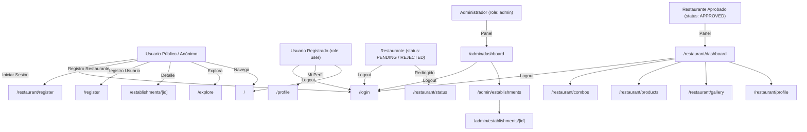

# Plan Técnico de Frontend: Cuentas y Gestión de Restaurantes (PlanATi)

> **Destinatario de ejecución:** Claude Code (CLI).  
> **Ubicación:** `PlanATi_Frontend/` (Directorio raíz del frontend).  
> **Contexto de ejecución:** Este documento contiene las especificaciones y el desglose de tareas ordenadas para implementar en Next.js (App Router) las interfaces y flujos de restaurantes, aprobaciones administrativas, catálogo de productos/combos, gestión de fotos, directorio público y perfil de usuario.

---

## 1. Objetivo y alcance

### 1.1 Objetivo
Desarrollar la interfaz de usuario en Next.js 16 (App Router), React 19 y Tailwind CSS v4 para:
1. Proporcionar una pantalla de registro visualmente independiente para que los restaurantes soliciten el alta de su establecimiento con los 9 campos requeridos y subida de imágenes (perfil y portada).
2. Ofrecer una vista informativa de estado para restaurantes con solicitud `PENDING` o `REJECTED`.
3. Construir el panel privado del restaurante para la gestión de su perfil, galería de fotos, fotos del menú físico, productos y combos (en sus dos modalidades: unitario independiente o compuesto por catálogo).
4. Proveer al administrador una consola para auditar solicitudes, consultar información del establecimiento, y aprobar o rechazar con motivo.
5. Mostrar el directorio público y el detalle de establecimientos aprobados, integrando una sección visual de reseñas (solo lectura) sin formularios de publicación.
6. Habilitar la vista de perfil de usuario regular (edición de información personal y cierre de sesión).
7. Gestionar el cierre de sesión unificado para los tres roles mediante cookies `HttpOnly` y protección de rutas.

### 1.2 Alcance fuera de esta fase (Exclusiones estrictas)
- **NO** implementar formulario de envío ni edición de calificaciones o comentarios de reseñas.
- **NO** implementar subida de fotos asociadas a reseñas.
- **NO** implementar respuestas de restaurantes a reseñas en el frontend.
- **NO** alterar flujos de Google OAuth existentes.
- **NO** crear pasarelas de pago ni carritos de compras.

---

## 2. Resumen del estado actual del frontend

| Componente | Estado actual | Detalle técnico |
|---|---|---|
| **Tecnologías clave** | Next.js 16.3.5, React 19.2.8, Tailwind CSS v4 | App Router con agrupadores de rutas: `(auth)`, `(home)`, `(public)`. |
| **Librería de estilos** | Tailwind CSS v4 (`@tailwindcss/postcss`) + Framer Motion | Configurado en `app/globals.css`. |
| **Iconografía** | Lucide React 1.51.0 | Utilizado para íconos en formularios. |
| **Cliente de API** | `lib/api.ts` y `lib/auth-api.ts` | Configurado con `credentials: "include"` para envío y recepción de cookies `HttpOnly`. |
| **Autenticación actual** | Login, registro y verificación OTP | Rutas en `app/(auth)/login`, `app/(auth)/register`, `app/(auth)/complete-profile`. |
| **Vistas públicas** | Placeholders básicos | `app/(public)/explore/page.tsx` y `app/(public)/details/page.tsx` contienen texto provisional. |
| **Protección de rutas** | Parcial / En componentes | No existe `middleware.ts`. La validación de sesión se realiza mediante `useEffect` en cliente. |

---

## 3. Archivos existentes que deben reutilizarse

1. **`lib/api.ts`:** Constante `API_URL` y helper base `apiFetch<T>`.
2. **`lib/auth-api.ts`:** Funciones de comunicación HTTP con cookies: `getAuthRequest`, `postAuthRequest`, `patchAuthRequest`, `logoutUser`, y clase `ApiError`.
3. **`components/ui/BrandMark.tsx`:** Isotipo y logotipo corporativo de PlanATi.
4. **`components/ui/SocialButton.tsx`:** Botón estandarizado de la aplicación.
5. **`app/globals.css`:** Variables CSS y directivas de Tailwind CSS.
6. **`app/layout.tsx`:** Layout raíz con fuentes Geist y viewport configurado.
7. **`app/(auth)/login/components/LoginForm.tsx` & `.ts`:** Lógica y estilos para autenticación por correo y contraseña.

---

## 4. Archivos que deben modificarse

1. **`lib/auth-api.ts`:**
   - Extender el tipo `AuthResponse` para incluir `role?: string` y `establishment_status?: string`.
   - Extender el tipo `UserProfile` con los campos necesarios de rol y estado.
2. **`app/(auth)/login/components/LoginForm.ts`:**
   - Adaptar la redirección tras login según el rol:
     - `admin` -> `/admin/dashboard`
     - `restaurant` con `APPROVED` -> `/restaurant/dashboard`
     - `restaurant` con `PENDING` o `REJECTED` -> `/restaurant/status`
     - `user` regular -> `/` o `/complete-profile` si el teléfono está pendiente.
3. **`app/(public)/explore/page.tsx`:**
   - Convertir en el directorio interactivo de restaurantes aprobados con barra de búsqueda, selector de categorías y tarjetas de establecimientos.
4. **`app/(public)/details/page.tsx`:**
   - Redirigir a la ruta dinámica `app/(public)/establishments/[id]/page.tsx` o implementar el visor de detalle público.
5. **`app/(home)/page.tsx`:**
   - Integrar barra de navegación global y enlaces al directorio público y accesos de usuario/restaurante.

---

## 5. Archivos nuevos que deben crearse

### 5.1 Enrutamiento y protección
- **`middleware.ts`:** Middleware de Next.js para proteger rutas `/admin/**`, `/restaurant/**` y `/profile`, verificando la existencia de la cookie `access_token` y redirigiendo a `/login` si no está autenticado.

### 5.2 Capa de API y Contratos
- **`lib/restaurant-api.ts`:** Tipos y métodos para consumir `/auth/restaurant/register`, `/restaurant/profile`, `/restaurant/status`, `/restaurant/upload-url`, `/restaurant/images`, `/restaurant/products` y `/restaurant/combos`.
- **`lib/admin-api.ts`:** Tipos y métodos para consumir `/admin/establishments`, `/admin/establishments/{id}`, `/approve` y `/reject`.
- **`lib/establishments-api.ts`:** Tipos y métodos para consumir `/establishments` y `/establishments/{id}` (públicos).

### 5.3 Módulo de Autenticación y Registro de Restaurantes
- **`app/(auth)/restaurant/register/page.tsx`:** Página contenedora del registro de establecimientos.
- **`app/(auth)/restaurant/register/components/RestaurantRegisterForm.tsx`:** Formulario interactivo con los 9 campos requeridos, validación reactiva, drag & drop para logo y banner, y manejo de errores 409.
- **`app/(restaurant)/restaurant/status/page.tsx`:** Vista para solicitudes en estado `PENDING` o `REJECTED`, mostrando explicaciones claras y botón para solicitar revisión tras corregir datos.

### 5.4 Consola Administrativa
- **`app/(admin)/layout.tsx`:** Layout administrativo con cabecera de sesión y barra lateral de navegación.
- **`app/(admin)/admin/dashboard/page.tsx`:** Resumen métrico del sistema (usuarios, establecimientos, solicitudes pendientes).
- **`app/(admin)/admin/establishments/page.tsx`:** Listado de restaurantes con pestañas de filtro (`PENDING`, `APPROVED`, `REJECTED`, `ALL`), buscador y tabla de acciones rápidas.
- **`app/(admin)/admin/establishments/[id]/page.tsx`:** Vista de auditoría detallada de la solicitud con visualización de fotos, datos del gerente, modal de aprobación y modal de rechazo con campo de motivo.

### 5.5 Panel de Gestión del Restaurante
- **`app/(restaurant)/layout.tsx`:** Layout del restaurante con menú lateral (Perfil, Fotos, Productos, Combos), badge de estado de la cuenta y botón de logout.
- **`app/(restaurant)/restaurant/dashboard/page.tsx`:** Vista de bienvenida con accesos directos al catálogo y perfil.
- **`app/(restaurant)/restaurant/profile/page.tsx`:** Editor de información comercial, logo, portada, descripción, teléfono y datos de contacto.
- **`app/(restaurant)/restaurant/gallery/page.tsx`:** Gestor de fotografías del establecimiento y fotos del menú físico.
- **`app/(restaurant)/restaurant/products/page.tsx`:** Gestor de productos individuales (tabla, alta, edición, eliminación con alerta de dependencia).
- **`app/(restaurant)/restaurant/combos/page.tsx`:** Gestor de combos con soporte para Modalidad 1 (unitario) y Modalidad 2 (compuesto con selector dinámico de productos existentes).
- **`components/restaurant/ProductModal.tsx`:** Modal reutilizable para crear y editar productos.
- **`components/restaurant/ComboModal.tsx`:** Modal para configurar combos (nombre, precio, imagen, tipo y selección de ítems).

### 5.6 Vistas Públicas y Perfil de Usuario
- **`app/(public)/establishments/[id]/page.tsx`:** Detalle público completo del restaurante (banner, logo, galería de fotos, carrusel de fotos de menú, catálogo de productos, combos destacados y sección visual de reseñas de solo lectura).
- **`app/(user)/profile/page.tsx`:** Vista de perfil personal del usuario registrado para consultar y modificar sus datos (`full_name`, `nickname`, `picture`, `phone_number`) y botón de cerrar sesión.
- **`components/common/Navbar.tsx`:** Barra de navegación unificada para escritorio y móvil que detecta el rol del usuario conectado y expone los enlaces pertinentes.
- **`components/common/ImageUploadField.tsx`:** Componente de subida de imágenes con previsualización local y carga directa a R2 vía URL prefirmada.

---

## 6. Rutas y navegación de cada actor

---

## 7. Componentes y responsabilidades

| Componente | Ruta o Ubicación | Responsabilidad principal |
|---|---|---|
| `Navbar` | `components/common/Navbar.tsx` | Cabecera global con logo, navegación pública, avatar y menú contextual según rol (`admin`, `restaurant`, `user`). |
| `RestaurantRegisterForm` | `app/(auth)/restaurant/register/components/` | Formulario de registro con validaciones en tiempo real para los 9 campos solicitados. |
| `StatusCard` | `app/(restaurant)/restaurant/status/` | Explicación del estado actual de la cuenta, mensaje de rechazo si aplica y opciones de reintento. |
| `EstablishmentsTable` | `app/(admin)/admin/establishments/` | Tabla administrativa con badges de estado (`PENDING`, `APPROVED`, `REJECTED`) y filtros. |
| `ApprovalActions` | `app/(admin)/admin/establishments/[id]/` | Botones de acción "Aprobar" y "Rechazar", con modal de confirmación y captura de motivo de rechazo. |
| `RestaurantProfileForm` | `app/(restaurant)/restaurant/profile/` | Formulario para actualizar información pública y de contacto del establecimiento. |
| `ImageGalleryManager` | `app/(restaurant)/restaurant/gallery/` | Gestor con pestañas ("Fotos del lugar" y "Fotos del menú"), carga múltiple y eliminación. |
| `ProductTable` | `app/(restaurant)/restaurant/products/` | Listado de productos simples con imagen, precio formateado en COP, switch de disponibilidad y acciones. |
| `ComboBuilder` | `components/restaurant/ComboModal.tsx` | Selector entre Modalidad 1 (Unitario) y Modalidad 2 (Compuesto), con cálculo de productos agregados. |
| `PublicEstablishmentDetail` | `app/(public)/establishments/[id]/` | Vista pública del restaurante que presenta banner, galería, menú de fotos, lista de productos/combos y bloque visual de reseñas. |
| `UserProfileForm` | `app/(user)/profile/` | Edición de datos personales del usuario y botón de logout con limpieza de credenciales. |

---

## 8. Contratos de API consumidos (Alineados con el Backend)

Todas las peticiones incluyen `credentials: "include"` para adjuntar automáticamente la cookie `access_token`.

### 8.1 Autenticación y Registro
- `POST /api/v1/auth/restaurant/register`:
  - **Body:** `{ account_email, password, manager_name, establishment_name, establishment_phone, contact_email, description, profile_image_url, banner_image_url }`
  - **Respuesta 201:** `{ user_id, establishment_id, role, establishment_status, message }`
- `POST /api/v1/auth/login`:
  - **Body:** `{ email, password }`
  - **Respuesta 200:** `{ registration_complete, requires_phone_verification, role, establishment_status }`
- `POST /api/v1/auth/logout`:
  - **Respuesta 204:** Cookie borrada por el backend.

### 8.2 Administración
- `GET /api/v1/admin/establishments?status=...&search=...`:
  - **Respuesta 200:** `Array<{ id, name, owner_email, manager_name, phone, contact_email, status, created_at }>`
- `GET /api/v1/admin/establishments/{id}`:
  - **Respuesta 200:** Detalle completo de la solicitud de registro.
- `POST /api/v1/admin/establishments/{id}/approve`:
  - **Respuesta 200:** `{ id, status: "APPROVED", message }`
- `POST /api/v1/admin/establishments/{id}/reject`:
  - **Body:** `{ reason: string }`
  - **Respuesta 200:** `{ id, status: "REJECTED", rejection_reason, message }`

### 8.3 Gestión de Restaurante
- `GET /api/v1/restaurant/status`:
  - **Respuesta 200:** `{ establishment_id, name, status, rejection_reason }`
- `GET /api/v1/restaurant/profile`:
  - **Respuesta 200:** Objeto completo del establecimiento autenticado.
- `PATCH /api/v1/restaurant/profile`:
  - **Body:** Campos actualizados del perfil.
- `POST /api/v1/restaurant/upload-url?folder=...`:
  - **Respuesta 200:** `{ upload_url, public_url, key }`
- `GET /api/v1/restaurant/images?image_type=...`:
  - **Respuesta 200:** `Array<{ id, image_url, image_type, caption, display_order }>`
- `POST /api/v1/restaurant/images`:
  - **Body:** `{ image_url, image_type, caption }`
- `DELETE /api/v1/restaurant/images/{id}`:
  - **Respuesta 204**
- `GET /api/v1/restaurant/products`:
  - **Respuesta 200:** `Array<ProductItem>`
- `POST /api/v1/restaurant/products`:
  - **Body:** `{ name, description, price, image_url, is_available }`
- `PATCH /api/v1/restaurant/products/{id}`:
  - **Body:** `{ name?, description?, price?, image_url?, is_available? }`
- `DELETE /api/v1/restaurant/products/{id}`:
  - **Respuesta 204** (o `409 Conflict` si está vinculado a un combo).
- `POST /api/v1/restaurant/combos`:
  - **Body:** `{ name, description, price, image_url, is_available, items: Array<{ product_id, quantity }> }`
- `PATCH /api/v1/restaurant/combos/{id}`:
  - **Body:** Campos y nueva lista de `items`.
- `DELETE /api/v1/restaurant/combos/{id}`:
  - **Respuesta 204**

### 8.4 Directorio y Detalle Público
- `GET /api/v1/establishments?search=...&category=...`:
  - **Respuesta 200:** Lista de restaurantes aprobados.
- `GET /api/v1/establishments/{id}`:
  - **Respuesta 200:** Objeto de establecimiento con `gallery_images`, `menu_images`, `products`, `combos` y `reviews_summary`.

### 8.5 Perfil de Usuario
- `GET /api/v1/users/me`
- `PATCH /api/v1/users/me`:
  - **Body:** `{ full_name?, nickname?, picture?, phone_number? }`

---

## 9. Gestión de formularios, validaciones y errores

1. **Formulario de Registro de Restaurante:**
   - `account_email`: Validación de sintaxis `/^[A-Za-z0-9._%+-]+@[A-Za-z0-9.-]+\.[A-Za-z]{2,}$/`.
   - `password`: Mínimo 8 caracteres, al menos 1 número, 1 mayúscula y 1 símbolo. Checklist interactivo visual en el formulario.
   - `establishment_name`: Obligatorio, longitud de 2 a 150 caracteres.
   - `establishment_phone`: Obligatorio, formato colombiano estándar (10 dígitos).
   - `contact_email`: Obligatorio, sintaxis de email válida.
   - `manager_name`: Opcional/recomendado, hasta 120 caracteres.
   - `description`: Opcional, texto enriquecido o multilínea.
   - `profile_image_url` y `banner_image_url`: Opcionales durante el alta, con zona de carga previa.
2. **Formulario de Combos (Modalidad 1 vs 2):**
   - Interruptor tipo pestaña: "Combo Unitario" vs "Combo Compuesto".
   - En Modalidad 2: Lista desplegable o buscador de productos ya creados por el restaurante, selector de cantidad por ítem, y cálculo visual del precio sugerido vs precio final del combo.
3. **Manejo uniforme de errores (`ApiError`):**
   - Detección de error `409 Conflict`: "Este correo de cuenta ya se encuentra registrado." o "El producto no se puede eliminar porque forma parte de un combo activo."
   - Detección de error `403 Forbidden`: Redirección automática a `/restaurant/status` si la cuenta no está aprobada.
   - Detección de error `401 Unauthorized`: Limpieza de sesión y redirección a `/login`.

---

## 10. Gestión de imágenes y estados de carga

1. **Flujo de carga directa a Cloudflare R2:**
   - Paso 1: El usuario selecciona un archivo en el navegador (`<input type="file" accept="image/jpeg,image/png,image/webp">`).
   - Paso 2: Validación en cliente de formato y tamaño máximo (máx. 5MB).
   - Paso 3: Llamada a `POST /api/v1/restaurant/upload-url?folder={folder}` con credenciales para obtener la `upload_url` presignada y la `public_url`.
   - Paso 4: Petición `PUT` directa desde el navegador a `upload_url` con el archivo binario (`Content-Type: image/jpeg`).
   - Paso 5: Al completar la subida, se usa la `public_url` en el formulario para registrar la entidad correspondiente.
2. **Estados visuales:**
   - Spinner y barra de progreso durante la subida a R2.
   - Skeletons de carga en tarjetas de directorio y listas de productos.
   - Estado vacío ilustrado cuando no hay fotos, productos o solicitudes pendientes.

---

## 11. Protección de rutas y comportamiento según rol y estado

### 11.1 Configuración de `middleware.ts`
El middleware interceptará las siguientes rutas:
- `/admin/:path*`: Requiere sesión activa; si no hay cookie `access_token`, redirige a `/login?redirect=/admin`.
- `/restaurant/:path*`: Requiere sesión activa; si no hay cookie, redirige a `/login?redirect=/restaurant`.
- `/profile`: Requiere sesión activa; si no hay cookie, redirige a `/login`.

### 11.2 Control de acceso en layouts de cliente
Dado que la cookie es `HttpOnly` y el rol se valida en el backend:
- En `app/(restaurant)/layout.tsx`: Al montar, consulta `GET /api/v1/users/me` y `GET /api/v1/restaurant/status`.
  - Si el rol no es `restaurant`, redirige a `/`.
  - Si el estado es `PENDING` o `REJECTED` y la ruta actual no es `/restaurant/status`, redirige de inmediato a `/restaurant/status`.
  - Si el estado es `APPROVED` y el usuario intenta entrar a `/restaurant/status`, redirige a `/restaurant/dashboard`.
- En `app/(admin)/layout.tsx`: Al montar, consulta `GET /api/v1/users/me`.
  - Si el rol no es `admin`, redirige a `/` con alerta de permisos insuficientes.

---

## 12. Plan de tareas ordenadas por dependencias

### Fase 0: Middleware, utilidades de API y tipos compartidos
- [x] **FE-TASK-01: Creación de clientes de API y middleware de autenticación**
  - **Archivos a leer:** `lib/api.ts`, `lib/auth-api.ts`.
  - **Archivos a modificar/crear:** `middleware.ts` (nuevo), `lib/restaurant-api.ts` (nuevo), `lib/admin-api.ts` (nuevo), `lib/establishments-api.ts` (nuevo), `lib/auth-api.ts`.
  - **Dependencias:** BE-TASK-02, BE-TASK-03.
  - **Resultado:** Clientes tipados para todos los endpoints del backend y middleware interceptando accesos no autenticados.
  - **Verificación:** Intentar entrar a `/restaurant/dashboard` sin cookie redirige a `/login`.

### Fase 1: Componente de subida de imágenes y Registro de Restaurantes
- [x] **FE-TASK-02: Componente reutilizable de subida de imágenes a R2**
  - **Archivos a leer:** `lib/restaurant-api.ts`.
  - **Archivos a crear:** `components/common/ImageUploadField.tsx`.
  - **Dependencias:** FE-TASK-01.
  - **Resultado:** Componente interactivo que solicita la URL prefirmada, sube a R2 y devuelve la URL pública con vista previa.
  - **Verificación:** Subida de imagen simulada o real generando URL pública sin errores.

- [x] **FE-TASK-03: Pantalla y formulario de registro de restaurantes**
  - **Archivos a leer:** `app/(auth)/login/components/RegisterForm.tsx`, `components/ui/BrandMark.tsx`.
  - **Archivos a crear:** `app/(auth)/restaurant/register/page.tsx`, `app/(auth)/restaurant/register/components/RestaurantRegisterForm.tsx`.
  - **Dependencias:** FE-TASK-02.
  - **Resultado:** Formulario completo con los 9 campos requeridos, validación reactiva y manejo de respuestas 201 y 409.
  - **Verificación:** Enviar formulario con datos válidos registra la cuenta y redirige a `/restaurant/status`.

### Fase 2: Vista de Estado de la Solicitud y Login Adaptativo
- [x] **FE-TASK-04: Pantalla informativa de estado del restaurante (`PENDING`/`REJECTED`)**
  - **Archivos a leer:** `lib/restaurant-api.ts`.
  - **Archivos a crear:** `app/(restaurant)/restaurant/status/page.tsx`.
  - **Archivos a modificar:** `app/(auth)/login/components/LoginForm.ts`.
  - **Dependencias:** FE-TASK-01, FE-TASK-03.
  - **Resultado:** Página que muestra el estado de la solicitud, notas del rechazo y botón para solicitar revisión. `LoginForm` redirige adecuadamente a cada rol y estado.
  - **Verificación:** Iniciar sesión con cuenta pendiente muestra la vista de espera sin permitir el acceso al panel.

### Fase 3: Consola Administrativa de Aprobaciones
- [x] **FE-TASK-05: Layout y vistas administrativas de auditoría de restaurantes**
  - **Archivos a leer:** `lib/admin-api.ts`.
  - **Archivos a crear:** `app/(admin)/layout.tsx`, `app/(admin)/admin/dashboard/page.tsx`, `app/(admin)/admin/establishments/page.tsx`, `app/(admin)/admin/establishments/[id]/page.tsx`.
  - **Dependencias:** FE-TASK-01.
  - **Resultado:** Consola para listar solicitudes filtradas por estado, ver detalles del restaurante, aprobar y rechazar con motivo.
  - **Verificación:** Admin aprueba solicitud; el restaurante cambia visualmente a `APPROVED` y puede ingresar a su panel.

### Fase 4: Panel Privado del Restaurante (Perfil, Fotos, Catálogo)
- [x] **FE-TASK-06: Layout y gestión de perfil del restaurante**
  - **Archivos a leer:** `lib/restaurant-api.ts`, `components/common/ImageUploadField.tsx`.
  - **Archivos a crear:** `app/(restaurant)/layout.tsx`, `app/(restaurant)/restaurant/dashboard/page.tsx`, `app/(restaurant)/restaurant/profile/page.tsx`.
  - **Dependencias:** FE-TASK-04.
  - **Resultado:** Panel privado accesible solo para aprobados, con edición de banner, logo, contacto y datos comerciales.
  - **Verificación:** Modificar nombre o teléfono del restaurante refleja los cambios inmediatamente.

- [x] **FE-TASK-07: Gestión de galería de imágenes y fotos del menú físico**
  - **Archivos a leer:** `components/common/ImageUploadField.tsx`.
  - **Archivos a crear:** `app/(restaurant)/restaurant/gallery/page.tsx`.
  - **Dependencias:** FE-TASK-06.
  - **Resultado:** Pestañas para cargar y eliminar fotos del lugar y fotos de cartas/menús físicos.
  - **Verificación:** Carga y eliminación de fotografías reflejadas en la vista.

- [x] **FE-TASK-08: Gestión de productos y combos (Modalidad 1 y Modalidad 2)**
  - **Archivos a leer:** `lib/restaurant-api.ts`.
  - **Archivos a crear:** `app/(restaurant)/restaurant/products/page.tsx`, `app/(restaurant)/restaurant/combos/page.tsx`, `components/restaurant/ProductModal.tsx`, `components/restaurant/ComboModal.tsx`.
  - **Dependencias:** FE-TASK-06.
  - **Resultado:** CRUD de productos individuales y combos. El modal de combos permite seleccionar productos del propio restaurante y fijar cantidades. Manejo de error 409 al intentar borrar productos enlazados a combos.
  - **Verificación:** Crear combo compuesto por 2 productos existentes y verificar persistencia en el backend.

### Fase 5: Directorio Público, Detalle y Perfil de Usuario
- [x] **FE-TASK-09: Directorio y buscador público de restaurantes aprobados**
  - **Archivos a leer:** `lib/establishments-api.ts`.
  - **Archivos a modificar:** `app/(public)/explore/page.tsx`, `app/(home)/page.tsx`.
  - **Archivos a crear:** `components/common/Navbar.tsx`.
  - **Dependencias:** FE-TASK-01.
  - **Resultado:** Listado público interactivo de restaurantes con búsqueda por texto y categoría, ocultando cualquier establecimiento no aprobado.
  - **Verificación:** Un restaurante en `PENDING` no aparece en las búsquedas ni en el listado.

- [x] **FE-TASK-10: Vista de detalle público del establecimiento con sección visual de reseñas**
  - **Archivos a leer:** `lib/establishments-api.ts`.
  - **Archivos a crear:** `app/(public)/establishments/[id]/page.tsx`.
  - **Archivos a modificar:** `app/(public)/details/page.tsx` (redirección a ruta dinámica).
  - **Dependencias:** FE-TASK-09.
  - **Resultado:** Visualización completa de fotos, fotos del menú, productos, combos y una sección preparada visualmente para reseñas (solo lectura, sin controles de envío ni edición).
  - **Verificación:** Carga correcta de todos los bloques en escritorio y móvil.

- [x] **FE-TASK-11: Vista de perfil del usuario regular y logout global**
  - **Archivos a leer:** `lib/auth-api.ts`.
  - **Archivos a crear:** `app/(user)/profile/page.tsx`.
  - **Dependencias:** FE-TASK-01.
  - **Resultado:** Pantalla donde el usuario puede consultar y editar sus datos personales y ejecutar el cierre de sesión seguro.
  - **Verificación:** Clic en logout elimina la cookie, limpia estados locales y redirige a `/login`.

---

## 13. Pruebas y criterios de aceptación

1. **Pruebas de navegación y permisos:**
   - Intentar acceder directamente por URL a `/restaurant/products` sin haber iniciado sesión -> Redirige a `/login`.
   - Iniciar sesión como restaurante con estado `PENDING` -> Redirige automáticamente a `/restaurant/status`. Intentar forzar la URL `/restaurant/profile` vuelve a redirigir a `/restaurant/status`.
   - Iniciar sesión como `admin` e ingresar a `/admin/establishments` -> Carga la lista de solicitudes.
2. **Pruebas de validación del formulario de registro:**
   - Dejar campos obligatorios vacíos (correo de cuenta, contraseña, nombre del establecimiento, teléfono, correo de contacto) -> Muestra los mensajes de error correspondientes y no envía la petición.
   - Usar contraseña sin requisitos mínimos -> Muestra los ítems faltantes en el checklist.
3. **Pruebas de Combos:**
   - Modalidad 1: Crear un combo sin productos asociados -> Se guarda como unidad independiente.
   - Modalidad 2: Crear un combo seleccionando 2 productos del catálogo -> Se visualizan los productos que lo componen en el resumen.
4. **Pruebas de la sección de reseñas:**
   - Verificar que en el detalle público se muestre el contenedor visual de reseñas (puntuación promedio, total), pero **sin** campos de texto, estrellas interactivas ni botones para agregar opiniones.

---

## 14. Decisiones pendientes y supuestos

1. **Gestión de URLs públicas y nombres de rutas:**
   - *Supuesto provisional:* Se adopta la ruta estándar de Next.js App Router `app/(public)/establishments/[id]/page.tsx` para el detalle de un restaurante, manteniendo `app/(public)/details/page.tsx` como redirección de compatibilidad si alguna vista previa la enlaza.
2. **Re-aplicación tras rechazo:**
   - *Supuesto provisional:* En `/restaurant/status`, si el estado es `REJECTED`, se habilita un botón "Modificar datos de la solicitud" que precarga el formulario con los datos existentes para permitir su reenvío.
3. **Sección de reseñas de solo lectura:**
   - *Supuesto provisional:* La sección de reseñas mostrará un bloque informativo "Próximamente podrás dejar tu reseña" y un resumen estático/mock si no hay reseñas reales previas en la base de datos.
